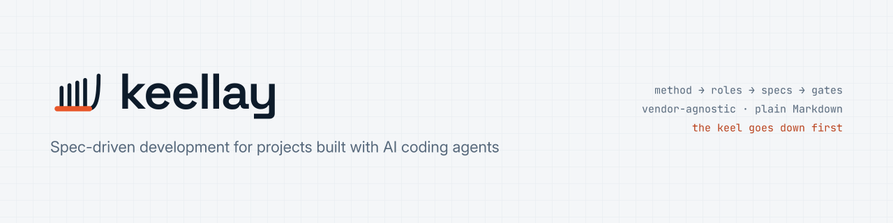

<picture>
  <source media="(prefers-color-scheme: dark)" srcset="assets/brand/banner-dark.svg">
  
</picture>

# Keellay

*Keel laying* is the ceremony that starts the building of a ship: the keel goes down first, and the whole hull is
built on it. Keellay lays that keel for software projects built with AI coding agents.

Keellay is a vendor-agnostic, spec-driven development (SDD) framework. It stores the **method** — roles, process,
artifact formats, gates and the rules that hold them together — and on `init` it derives a project's own setup from
it: role skills generated for the project's stack and needs, documents, indexes and checks.

- **Greenfield** — an empty project gets the method laid down from scratch.
- **Brownfield** — an existing project is analysed first (its structure, existing skills, agent instructions and
  documents), and Keellay proposes how to move it onto the method instead of overwriting what is there.

How the parts fit together and how a project runs on Keellay: [docs/architecture.md](docs/architecture.md).

## Status

Design decided, first commands built. `keellay paths` shows where a project's artifacts live, and `keellay check`
checks their front matter, numbers, indexes and links; `init` is not implemented yet. Nothing is published.

## Repository layout

| Path | What it holds |
|---|---|
| [method/](method/) | The method in plain Markdown: layout, strictness levels, role contracts, artifact formats, procedures |
| [src/keellay/](src/keellay/) | The `keellay` CLI (Python); it ships a copy of `method/` inside the package. Per-agent wiring lives in [src/keellay/agents/](src/keellay/agents/) |
| [tests/](tests/) | CLI tests and a smoke test for the built wheel |
| [docs/architecture.md](docs/architecture.md) | How Keellay is meant to work: parts, flows and what is built so far |
| [docs/specs/](docs/specs/) | Keellay's own living specs: what the CLI does now |

## Development

Requires [uv](https://docs.astral.sh/uv/).

```
uv sync            # create the environment
uv run pytest      # run the tests
uv run keellay info
uv run keellay check  # check this repository's specs, deltas and method links
uv build           # build the sdist and wheel into dist/
```

CI runs the tests, builds the package and smoke-tests the wheel on Linux, macOS and Windows, and runs
`keellay check` on this repository.

Pull requests are squash-merged: the PR title becomes the commit title and the description becomes its body. Branches
are named `<type>/<change ID>` (`feat/C0007-session-expiry`), or `<type>/<topic>` without a change, with the types
`feat`, `fix`, `docs`, `ci`, `chore`, `refactor`, `test`; the first commit of a branch is written as the title of the
whole PR. CI fills in what is missing:

- a title that is not `<type>: <summary>` becomes the first commit's subject, or else the branch topic;
- an empty description becomes the body of the only commit, or a list of the commits with their bodies;
- AI attribution lines are removed from the description, also on a branch outside the naming convention, where CI
  changes nothing else;
- description lines longer than 72 characters are wrapped, list items with a hanging indent, because GitHub wraps the
  commit body at 72 itself; write a list item or paragraph as one line and let CI wrap it;
- on `fix/` branches the `Current:`, `Expected:` and `Unchanged:` lines of [the bugfix format](method/formats/bugfix.md)
  are required.

Commits cannot be fixed by CI, so on every branch it fails a pull request with a commit that would bring AI
attribution into `main`: an attribution line in the message (`Co-Authored-By: Claude`, `Claude-Session:` and the
like), or an author or committer that is not a GitHub noreply address (`<id>+<login>@users.noreply.github.com`; the
committer may also be GitHub itself, for commits made on github.com) or is the GitHub account of an AI coding agent
(`claude[bot]`, `Copilot` and the like; other bots such as `dependabot[bot]` pass). At a squash merge GitHub turns
every commit author other than the merger into a `Co-authored-by` line, so the author counts as much as the message.

## Principles (draft)

- **Method, not templates.** The framework is versioned in one place; each project gets a small adapter and its own
  generated roles, checked against a contract.
- **Vendor-agnostic.** Plain Markdown and scripts at the core; role skills follow the open Agent Skills
  format, and connecting them to each agent is a thin layer of wiring. Checks run in git hooks and
  CI, so they hold whatever agent wrote the change.
- **The owner decides.** Agents restate the request, show options with a recommendation, and act after a yes.
- **Mechanisms over memory.** A lesson that repeats becomes a hook, a checklist item or a rule.
- **Right-sized ceremony.** A small fix needs no plan; a large change gets specs, a plan and an independent review.

## License

[MIT](LICENSE)
