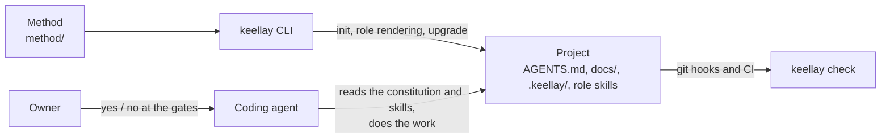

# Architecture

How Keellay is meant to work: its parts, how they fit together, and how a project runs on it. This is a statement of
intent. Most of it is not built yet; [Status](#status) at the end says what exists today. What the built parts do
exactly is in the living specs in [specs/](specs/).

## The idea in one paragraph

Keellay keeps one **method** — roles, process, artifact formats, gates and checks — versioned in one place. A project
does not copy it. `keellay init` lays the method into the project: a small configuration, the project's documents
and indexes, role skills generated for that project, and checks wired into git hooks and CI. Coding agents do the
work by reading those files; the owner decides at the gates; the checks hold whatever agent wrote the change. When the
method improves, the project upgrades, and its own content survives.

## Who does what

Every step belongs to one of three actors, by what kind of work it is:

| Actor | Does | Examples |
|---|---|---|
| **CLI** | deterministic work: the same input always gives the same output | lay out files, render role skeletons, resolve paths, merge spec deltas, run checks |
| **Agent** | judgment, following one of Keellay's written procedures | analyse a project, fill a role's project sections, write a plan, implement, review |
| **Owner** | decisions | approve a change and its path, accept a plan, say yes before anything is written into an existing project |

Nothing that needs judgment is hidden in a template, and nothing deterministic is left to an agent's memory.

## Parts



### The method — [method/](../method/)

Plain Markdown that any agent can read:

- [layout.md](../method/layout.md) — where a project's artifacts live by default and how a project overrides it;
- [levels.md](../method/levels.md) — how much ceremony a project and a single change get;
- [contracts/](../method/contracts/) — what each role skill must contain, independent of any project;
- [formats/](../method/formats/) — the artifact formats: change, living spec, delta, bugfix, ADR, lesson and more;
- [procedures/](../method/procedures/) — step-by-step instructions for agents: role generation, brownfield analysis,
  closing a change.

### The CLI — [src/keellay/](../src/keellay/)

- **Python, installed through [uv](https://docs.astral.sh/uv/).** `uvx keellay …` runs it without installing;
  `uv tool install keellay` keeps it. uv brings its own Python, so a Flutter or Go project needs no extra runtime in
  its build.
- **The method travels inside the package.** The CLI reads the copy it was released with, so a project always knows
  which version of the method it runs on.
- **One JSON object per command.** Every command prints its result as one line of JSON, so agents and scripts parse it
  instead of guessing. The commands and their output are the contract; the implementation behind them can be replaced
  later (for example by a native binary) without changing projects.

### Agent wiring — [src/keellay/agents/](../src/keellay/agents/)

Role skills are generated once, in the open Agent Skills format (a folder with `SKILL.md`), the same for every agent.
What differs between agents is where they look for skills, how they read `AGENTS.md` and where hooks are registered.
Each agent gets a small wiring module that handles exactly that and nothing else. The first targets are Claude Code
and agents that read `AGENTS.md`.

### Checks — [src/keellay/checks/](../src/keellay/checks/)

Scripts behind `keellay check`, run from git hooks and from CI: an index changes in the same commit as its section,
links in documents resolve, a branch matches its change, and project-specific code rules hold. Agent hooks only call
the same command. Because the checks live in git and CI, they apply to every change, whichever agent or human made it.
What is built so far is in the [check spec](specs/check.md); the rest is named under "Checked by" in each format.

## What a project gets

```
AGENTS.md            the project's own file; one line points agents to the constitution
docs/
  constitution.md    what every agent reads first: the project, who decides, what to read, project-wide rules
  product/           PRD, ideas register
  specs/             living specs: what the system does now, one per capability
  changes/           open changes with plans and spec deltas; closed ones in changes/archive/
  adr/               decisions, append-only, with an index of what is in force
  lessons/           lessons from retros, with an index of the active ones
.keellay/
  config.toml        method version, strictness level, section paths, agents
  manifest.json      generated files with their contract version and content hash
```

Every section has an index. Any section can live elsewhere: `config.toml` maps it to the project's own path, and
every tool finds sections through one resolver, `keellay paths`, instead of hardcoding them. Role skills go where
each agent expects them.

Every project has four core roles — `product-owner`, `architect`, `developer`, `manager` — generated from fixed
contracts. More roles appear only as instances of a core contract (say `developer-flutter` in a multi-stack repository)
or from Keellay's catalogue of contracts, with the owner's yes. No role is free-form, so every role can be checked.

## How it runs

### Laying the keel: `keellay init`

- **Greenfield.** An empty project gets the default layout, the constitution, the core roles and the checks for its
  level. No configuration is needed up front.
- **Brownfield.** An existing project is analysed first: its structure, agent instructions, existing skills,
  documents, ADRs, tasks, hooks and CI. Keellay detects what it can and asks only about the rest. The result is a
  report with a proposal for every artifact — keep, convert or archive — and for every section — map it in place or
  move it to the default. **Nothing is written before the owner's yes.** Living specs start empty: a capability's spec
  appears with the first change that touches it, from the standard level up. An existing project usually starts at the
  light level and moves up through an ADR.

### Role skills: rendered, filled, checked

1. The CLI renders a skill's skeleton from its contract: the required sections, the method's fixed rules, references
   and a header recorded in the manifest.
2. An agent fills the marked project sections by Keellay's procedure, from evidence in the repository, and asks the
   owner what it cannot infer.
3. The CLI checks the structure: every required section is there, no fill markers are left, no names from other
   projects slipped in, size limits hold, links resolve. Behavioural evals — scenario prompts with expected behaviour —
   are run by the agent.

**Upgrades.** When the method changes, the CLI re-renders the fixed parts, keeps the filled ones and shows the diff.
The manifest tells generated content from the project's own edits.

### A change, from request to close

Ceremony is set on two axes ([levels.md](../method/levels.md)). The **project level** — light, standard (the default)
or strict — decides which mechanisms are installed. The **path** of each change decides what that change goes through;
the architect proposes it and the owner confirms:

| Path | For | Goes through |
|---|---|---|
| fix | a defect with known expected behaviour | current / expected / unchanged, and a test; no plan |
| change | small, one area, low risk | a short plan; a spec delta if behaviour changes |
| feature | a new capability, several areas, or high risk | idea or PRD entry → intent, scope and spec delta → plan with phases → work in waves → fresh-context review → close |

At the light level there are no living specs yet, so no path writes a delta; the fresh-context review at close still
runs.

A change is a folder with a plan and, when behaviour changes, a **delta** next to the specs: the requirements it adds,
modifies or removes. The delta can be reviewed as the intended behaviour before any code is written. The architect
writes what the change is; the developer, who knows the code, cuts it into phases — vertical slices, each tagged with
the role that owns it and saying when it is done — and the architect and the product owner review the cut before the
owner approves the plan. The architect checks every finished phase against its done-when with a code review; the
product owner also checks phases with a result a user can see, in a change that serves a PRD area or an idea. The
manager is a dispatcher: it routes a new request, every hand-off between roles goes through it, and it starts each
wave; it acts on hand-offs, not on every skill call.

**Close.** The CLI merges the delta into the living specs by requirement ID — when the change goes to review, or in
the implementing pull request when plans and specs are kept in different repositories — and validates the result:
every added or modified requirement is there with its new text, removed ones are gone, and no requirement is touched
by another open change. At every level an architect in a **fresh context** — a new session that did not do the work —
checks the change against its intent, scope and done-when, its code and its documents, and, where there are specs, the
merged specs against the code and tests; for a change that serves a PRD area or an idea the product owner checks it,
and from the standard level up the manager runs the retro. With the owner's yes the areas whose Outcome the change
reached become `delivered`, and the change is closed and moved to the archive. The specs now describe the system as it
is.

### Lessons become mechanisms

Before a change closes, from the standard level up, a retro records what went wrong as lessons, one file each, with a
count of how often each one happened. A lesson that repeats has to become a mechanism — a hook, a check, a rule in a
role skill, a checklist item or, weakest, a rule in the constitution — before the change in which it repeated closes.
A small one is made at review with the owner's yes; for a large one the owner may waive it for that change while it is
built in a change of its own; a lesson that needs the method itself changed is recorded as input for Keellay. A
mechanism holds where a reminder depends on the next session reading it.

## Status

| Part | State |
|---|---|
| Method: layout, levels | decided |
| Method: formats for change, spec, delta, bugfix, ADR, lesson, PRD, idea, constitution | draft |
| Method: role contracts | draft |
| Method: procedures | planned |
| CLI: `--version`, `info`, JSON output | built — [specs/cli.md](specs/cli.md) |
| CLI: `paths` | built — [specs/paths.md](specs/paths.md) |
| CLI: `init` | in the interface, reports `not_implemented` |
| CLI: role rendering, upgrades, delta merge | planned; commands not named yet |
| Agent wiring: Claude Code, `AGENTS.md` agents | planned |
| Checks: front matter, numbers, indexes, links, phases of a plan | built — [specs/check.md](specs/check.md) |
| Checks: the rest named under "Checked by" in the formats | planned |
| Packages on PyPI | not published |
